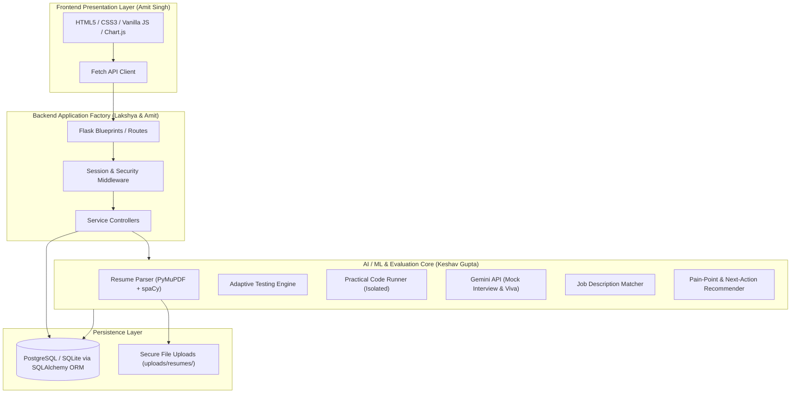

# SkillPilot AI — System Architecture Specification

## 1. System Overview
**SkillPilot AI** is an AI-powered student skill, career, and placement readiness platform. It bridges the critical divide between static resume claims and real student competencies through evidence-based assessments, AI mock interviews, code evaluation, and job description alignment.

### Core Value Proposition
```
CLAIMED SKILL (Resume) ➔ VERIFIED SKILL (Evidence) ➔ JOB-REQUIRED SKILL (JD Match)
```

### Continuous Development Cycle
```
TEST → ANALYSE → DIAGNOSE → IMPROVE → RETEST → UPDATE PROFILE
```

---

## 2. Technology Stack (Strict Standard)
- **Frontend Layer**: HTML5 Semantic markup, CSS3 custom design tokens, Vanilla JavaScript (ES6+), Fetch API, Chart.js.
- **Application & API Layer**: Python 3, Flask (Application Factory pattern), Flask-SQLAlchemy, Flask-Migrate, Flask-CORS (scoped).
- **Persistence Layer**: PostgreSQL (Production) with automatic SQLite fallback (`instance/skillpilot.db`) for zero-friction local development.
- **NLP & Resume Extraction**: PyMuPDF (`fitz`), spaCy, regex tokenization.
- **Machine Learning & Analytics**: Pandas, NumPy, Scikit-learn.
- **Generative AI Engine**: Google Gemini API (Server-side integration only via `google-generativeai`).
- **Testing**: Pytest.

---

## 3. High-Level Modular Architecture



---

## 4. Key Architectural Safeguards
1. **Never Treat Claims as Proof**: A skill parsed from a resume is categorized as `Claimed` until substantiated by a test score, coding pass, or viva evaluation (`Verified`).
2. **Safe Code Execution**: Student-submitted code in the coding module is executed within isolated environments with strict memory, CPU, time, and network constraints. It is **never** executed inside the main Flask process.
3. **Server-Side AI Secrets**: The Gemini API key is stored exclusively in server environment variables and never exposed to the client.
4. **Explainable AI**: The AI recommendation engine provides clear rationale and concrete next-best actions rather than generic black-box outputs.
