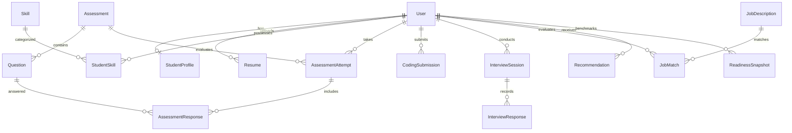

# SkillPilot AI — Database Design & Entity Relationship

## 1. Relational Model Overview
The database uses **PostgreSQL** in production with **SQLAlchemy ORM** mapping. For local development where PostgreSQL may not be immediately available on a student machine, the application safely falls back to local SQLite (`instance/skillpilot.db`).

---

## 2. Core Entities & Schema Definition

### 1. `users`
| Column | Type | Constraints | Description |
| :--- | :--- | :--- | :--- |
| `id` | Integer | PK, Auto-increment | Primary Identifier |
| `name` | String(120) | NOT NULL | Full name of the user |
| `email` | String(120) | NOT NULL, UNIQUE, Indexed | Student institutional or personal email |
| `password_hash` | String(255) | NOT NULL | Salted password hash (Werkzeug) |
| `role` | String(20) | NOT NULL, DEFAULT 'student' | Role: student / admin |
| `created_at` | DateTime | DEFAULT UTC NOW | Record creation timestamp |

### 2. `student_profiles`
| Column | Type | Constraints | Description |
| :--- | :--- | :--- | :--- |
| `id` | Integer | PK, Auto-increment | Primary Identifier |
| `user_id` | Integer | FK(`users.id`), UNIQUE | 1-to-1 relationship with User |
| `college` | String(180) | Nullable | College or university name |
| `education` | String(120) | Nullable | Degree / Branch (e.g. B.Tech CSE) |
| `graduation_year`| Integer | Nullable | Target graduation year |
| `target_role` | String(120) | Nullable | Desired career role (e.g. SDE-1) |
| `experience_summary` | Text | Nullable | Brief experience summary |

### 3. `resumes`
| Column | Type | Constraints | Description |
| :--- | :--- | :--- | :--- |
| `id` | Integer | PK, Auto-increment | Primary Identifier |
| `user_id` | Integer | FK(`users.id`), Indexed | Uploading student |
| `original_filename`| String(255) | NOT NULL | Uploaded filename |
| `stored_filename` | String(255) | NOT NULL, UNIQUE | Secure random identifier on disk |
| `file_type` | String(20) | NOT NULL | MIME / Extension (pdf) |
| `extracted_text` | Text | Nullable | Sanitized raw text from PyMuPDF |
| `upload_date` | DateTime | DEFAULT UTC NOW | Upload timestamp |
| `processing_status`| String(30) | DEFAULT 'pending' | pending / parsed / failed |

### 4. `skills` & `student_skills`
- **`skills`**: `id`, `name`, `category` (Technical / Soft / Tool), `description`.
- **`student_skills`**: Bridge table tracking `student_id`, `skill_id`, `claimed_level`, `verified_level`, `evidence_source` (resume/test/coding/viva), `last_updated`.

### 5. `assessments` & `questions`
- **`assessments`**: `id`, `title`, `category` (Python/DSA/DBMS/Web), `difficulty`, `total_marks`, `duration`.
- **`questions`**: `id`, `assessment_id`, `question_text`, `question_type` (MCQ/MSQ), `options_json`, `correct_answer`, `explanation`, `difficulty`, `topic`.

### 6. `assessment_attempts` & `assessment_responses`
- **`assessment_attempts`**: `id`, `student_id`, `assessment_id`, `score`, `started_at`, `completed_at`.
- **`assessment_responses`**: `id`, `attempt_id`, `question_id`, `submitted_answer`, `is_correct`, `marks_awarded`.

### 7. `coding_submissions`
- **`coding_submissions`**: `id`, `student_id`, `question_id`, `submitted_code`, `language`, `execution_status`, `test_results`, `score`, `created_at`.

### 8. `interview_sessions` & `interview_responses`
- **`interview_sessions`**: `id`, `student_id`, `target_role`, `interview_type` (Technical/HR), `status`, `created_at`.
- **`interview_responses`**: `id`, `session_id`, `question`, `answer`, `evaluation`, `score`.

### 9. `job_descriptions` & `job_matches`
- **`job_descriptions`**: `id`, `title`, `company`, `description`, `extracted_skills`, `created_at`.
- **`job_matches`**: `id`, `student_id`, `job_id`, `match_score`, `missing_skills`, `matched_skills`, `created_at`.

### 10. `recommendations` & `readiness_snapshots`
- **`recommendations`**: `id`, `student_id`, `recommendation_type`, `title`, `description`, `priority`, `completed`, `created_at`.
- **`readiness_snapshots`**: `id`, `student_id`, `overall_score`, `technical_score`, `coding_score`, `communication_score`, `interview_score`, `project_score`, `created_at`.

---

## 3. Entity Relationship Diagram (ERD)

